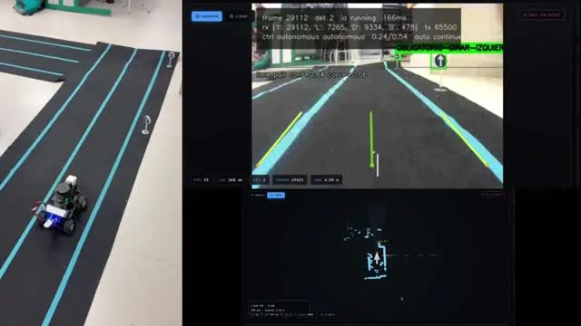
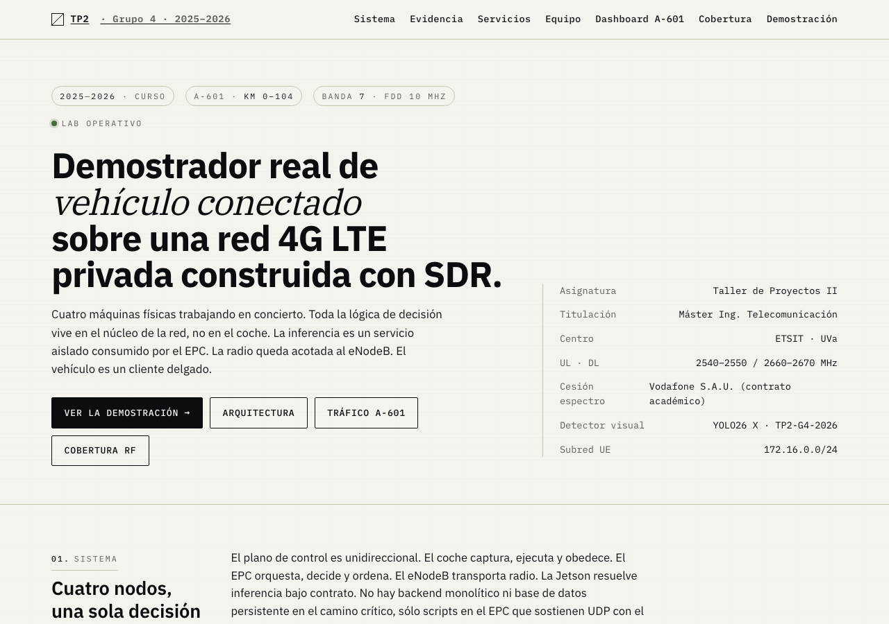
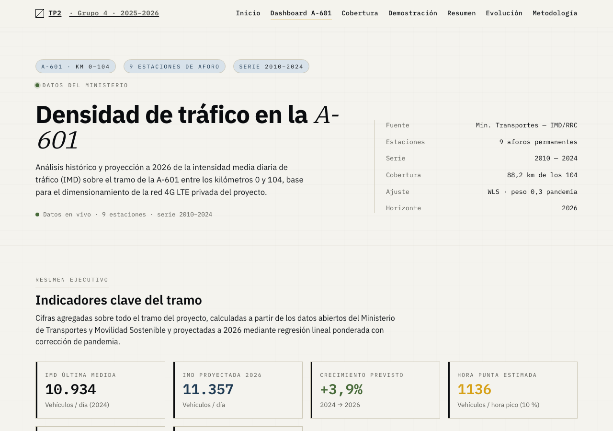
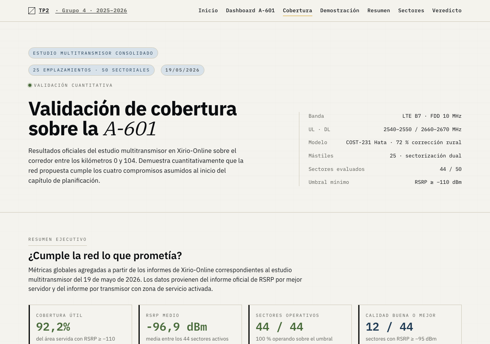

# A connected vehicle on a private LTE network

A small car as user equipment on a 4G network we built ourselves, with the driving decisions taken in the core and inference at the edge. Four machines: an EPC host running the LTE core and the control runtime, an eNodeB on a bladeRF SDR, a Jetson Orin Nano as inference node, and an AWS DeepRacer carrying the camera, LiDAR and IMU. Camera frames and telemetry go up over LTE, traffic-sign detections become steering and throttle commands, and the commands come back down the same path.

Taller de Proyectos 2, Master's in Telecommunications Engineering, University of Valladolid, spring 2026. Team of three: Alonso Sandoval, Mario Medrano and Luis F. Sánchez. The original repository is [TallerProyectos2/TP2](https://github.com/TallerProyectos2/TP2); the project site, which I built, is at [tallerproyectos2.github.io/TP2](https://tallerproyectos2.github.io/TP2/).

<p align="center">
  
</p>

## How it is split

| Machine | Role |
| --- | --- |
| EPC PC | LTE core (srsRAN 4G EPC), UE routing, the UDP control runtime, web operator UI, local inference fallback, session recording |
| eNodeB PC | radio access only: `srsenb` on a bladeRF 2.0 xA9, band 7, 10 MHz FDD |
| Vehicle | LTE UE, camera and sensor capture, command execution; no global decisions |
| Jetson Orin Nano | inference-only offload endpoint |

The control plane is one-directional. The car captures and obeys; the EPC orchestrates, decides and commands; the eNodeB moves radio; the Jetson answers inference requests. Every runtime decision is visible from the EPC, which is what makes the system auditable.

## Runtime

1. The EPC brings up the core and routing; the eNodeB brings up the radio.
2. The car attaches as UE and streams frames, battery, LiDAR scans and IMU telemetry over UDP to `servicios/coche.py`.
3. Traffic signs are detected by a YOLO model behind a Roboflow-compatible inference server, on the EPC or on the Jetson.
4. `servicios/autonomous_driver.py` turns detections into actions with a deterministic state machine: track signs over time, resolve ambiguous detections, apply cooldowns, fall back to neutral when frames or predictions go stale.
5. Three safety layers adjust or override: OpenCV lane detection to hold the taped track, LiDAR obstacle protection that slows or stops the car, IMU-based speed estimation with a bounded PID on the throttle. Steering trim compensates known mechanical drift.
6. A compact UDP packet goes back to the car. The browser UI shows live video, status, manual and autonomous modes, tuning and recording.

Sessions are recorded for replay, relabelling and retraining. `ops/` holds the startup, shutdown and validation scripts and the systemd units that make a four-machine start repeatable; `docs/logs/validations/` keeps the evidence for every runtime change.

## From the lab to the A-601

The second half of the project is a deployment study for the Valladolid–Segovia corridor, km 0 to 104: traffic demand from the Ministry's IMD data projected to 2026, cell capacity, radio planning in Xirio with 25 sites and 44 sectors, mast placement, equipment sizing, cost model and the Spanish regulatory procedure for a band 7 deployment on spectrum ceded by Vodafone. The data and the dashboards are in `docs/`.

<p align="center">
  
</p>
<p align="center">
  
  
</p>

## Layout

```
servicios/     Python runtime: car control, inference client, autonomous policy, lane and LiDAR logic, replayer
ops/           bring-up, shutdown, validation, systemd units, sudoers templates
docs/          architecture, per-machine runbooks, network contract, inference notes, reliability, the project site and the A-601 study data
docs/logs/     validation evidence
tests/         unit tests for the autonomous decisions, lane detection, LiDAR processing and runtime behaviour
SoftARTEMIS/   vehicle-side support files
```

```bash
PYTHONPATH=servicios python -m unittest discover -s tests
```

Python, NumPy, OpenCV; srsRAN 4G; bladeRF; Roboflow Inference with a YOLO model; a Jetson Orin Nano; systemd, Bash and SSH for orchestration. The lab itself is physical, so there is no one-command demo; secrets and machine-local settings live outside the repository.
